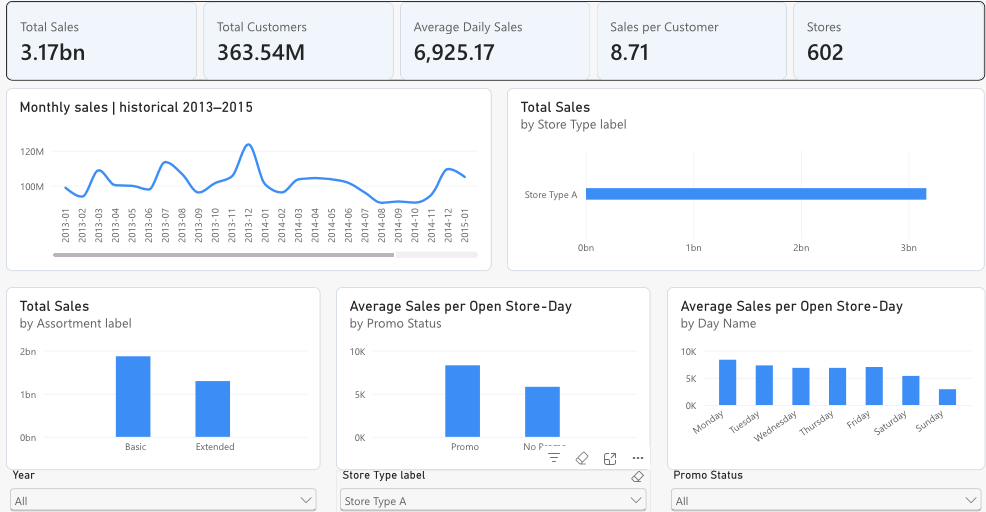

# Hi, I am Leonard

Final-year BSc Computer Science and Digitalization student in Berlin, focused on data analytics and business intelligence. I am seeking internship and working-student opportunities in data analysis, BI and reporting.

## Selected academic projects

| Project | Focus | Tools and methods |
| --- | --- | --- |
| [Rossmann Store Performance](https://github.com/LeoObianisi/LeoObianisi/tree/main/rossmann-powerbi-analysis) | Retail dashboards and sales planning | Power BI, Power Query, DAX |
| [NYC 311 Service Request Analytics](https://github.com/LeoObianisi/LeoObianisi/tree/main/nyc311-service-request-analytics) | Data collection, validation and service-demand analysis | Python, pandas, SQL, PySpark, Google Cloud Dataproc |
| [Yellowstone Delivery Simulation](https://github.com/LeoObianisi/LeoObianisi/tree/main/yellowstone-delivery-simulation) | Written case study on delivery uncertainty and operational planning | Monte Carlo simulation, probability, process modelling |

Each project folder contains its original academic report, available source files and selected visuals. The project READMEs explain what is included and the scope of the work.

## Dashboard preview

## Areas of interest

Data analysis, Power BI reporting, data quality and practical applications of AI.
