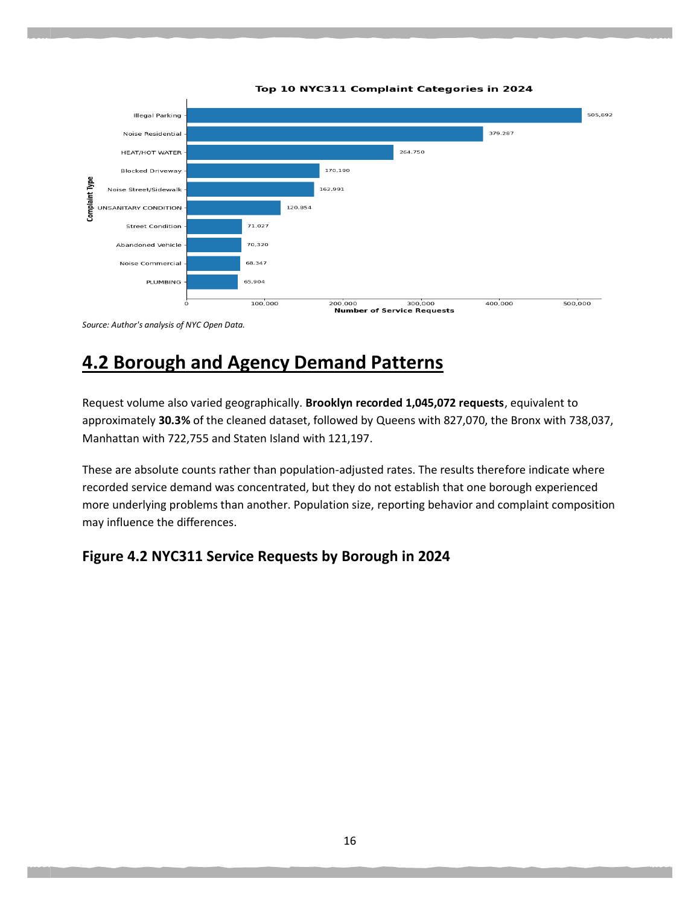

# NYC 311 Service Request Analytics

Python and Spark case study exploring service demand and recorded resolution times for New York City 311 requests created during 2024.

## Business question

Where and when is recorded service demand concentrated, and how do resolution-time patterns vary across boroughs and agencies?

## Tools and workflow

Python, pandas, requests, Matplotlib, PySpark, Spark SQL, Google Cloud Storage and Dataproc.

The workflow progresses from API collection and a 500,000-record pandas prototype to annual data validation and Spark aggregation. The report documents 3,456,769 raw annual records, checks on unique keys and date coverage, and 3,454,131 records after cleaning. It also discusses CSV/Parquet and caching experiments on a single-node Dataproc configuration.

## Preview

## Project files

- [Original academic report](reports/nyc311-report.pdf)
- [Download notebook for the initial 500,000-record prototype](notebooks/NYC311_01_Download_Data.ipynb)
- [Prototype profiling and analysis notebook](notebooks/NYC311_02_Baseline_Profile.ipynb)
- [Full-year PySpark analysis script](src/nyc311_full2024_analysis.py)

## Using the code

The download notebook retrieves the initial prototype from the NYC Open Data API. Run it before the profiling notebook, using the same working directory so their relative data paths agree. Its installation cell uses pandas and requests; the profiling notebook also uses Matplotlib.

The full-year Spark script expects annual CSV chunks already stored in Google Cloud Storage. Its RAW, OUT and PARQUET paths reflect the original cloud environment and need to point to your own storage before running it with PySpark. Its output writes use overwrite mode. Full-year extraction and benchmark scripts are not included in this collection. Raw datasets are not bundled.

The prototype notebooks and the final annual analysis cover different date ranges. Use the report for the final annual findings. Recorded request counts are not population-adjusted rates; closure times also depend on complaint mix and agency processes.

## Context and data source

Academic project by Obianisi Leonard Tochukwu for the BSc Computer Science and Digitalization programme. Original reports, code and saved notebook outputs are preserved. They have not been rerun for this portfolio upload.

[NYC Open Data 311 dataset](https://data.cityofnewyork.us/Social-Services/311-Service-Requests-from-2020-to-Present/erm2-nwe9)
