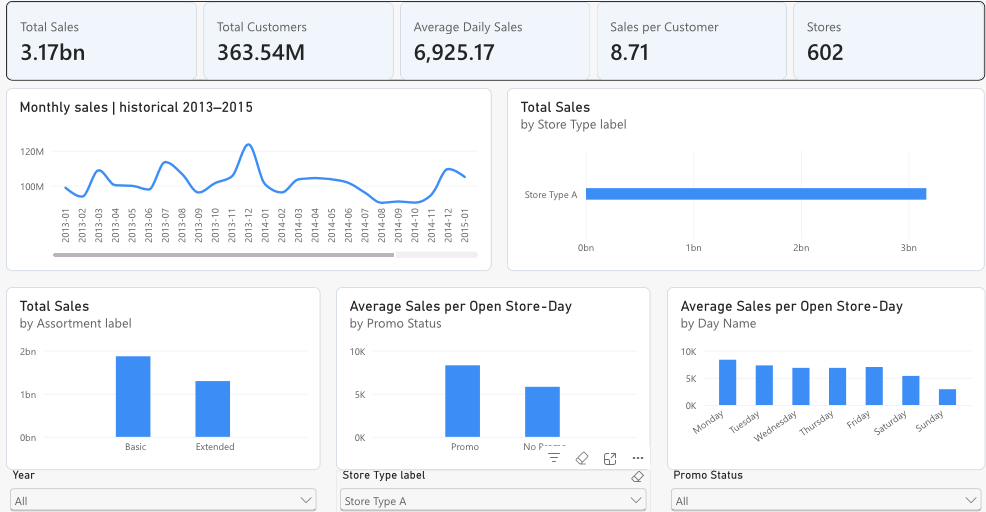
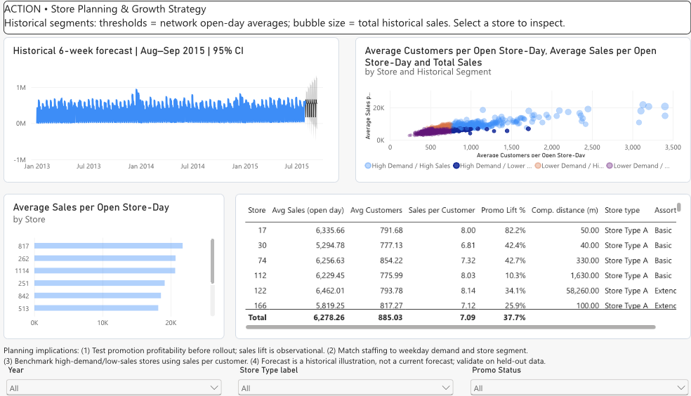

# Rossmann Store Performance and Sales Planning

Power BI case study examining historical store performance, customer traffic and promotions across 1,115 Rossmann stores in Germany.

## Business question

How can historical store data support sales planning and identify stores requiring management attention?

## Tools and approach

Microsoft Power BI, Power Query and DAX. The report uses a one-to-many sales/store model and three connected dashboard pages: Executive Sales Overview, Sales Drivers and Promotion Analysis, and Store Planning and Growth Strategy.

Analysis covers sales per open store-day, sales per customer, promotional comparisons, customer–sales regression, rule-based store segments and an illustrative six-week forecast.

## Preview

## Project files

- [Original academic report](reports/rossmann-report.pdf)
- Dashboard screenshots extracted from the report in the images folder.

The dataset covers January 2013 to July 2015. Promotional comparisons describe associations, the segments use explicit rules, and the forecast was not validated on held-out observations. The interactive Power BI link is in the report appendix and may require organisational sign-in. A PBIX file is not included in this repository.

## Context

Academic project by Obianisi Leonard Tochukwu for the BSc Computer Science and Digitalization programme. The original assignment is preserved as submitted. Dataset reference: Rossmann Store Sales, Kaggle.
