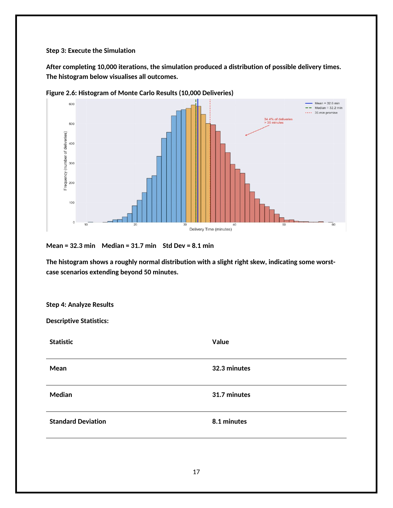

# Yellowstone Delivery Simulation

Academic simulation case study exploring how uncertain delivery times can inform service promises and operational planning.

## Business question

How can a delivery business account for traffic and driver variability when setting delivery-time promises?

## Methods covered

- Monte Carlo simulation with 10,000 delivery scenarios.
- Assumed delivery-time, traffic-delay and driver-experience distributions.
- Histograms, percentiles and cumulative distributions for interpreting uncertainty.
- Process modelling with Petri nets and UML.

## Preview

## Project files

- [Original academic report](reports/yellowstone-simulation-report.pdf)
- A preview page exported from the report in the images folder.

This repository presents the original written case study, including its code screenshots, diagrams and reported outputs. A standalone runnable simulation program and raw output files are not included. The scenario assumptions are illustrative and should not be treated as measured business performance or independently validated operational recommendations.

## Context

Academic project by Obianisi Leonard Tochukwu for the BSc Computer Science and Digitalization programme. The assignment is preserved as submitted.
